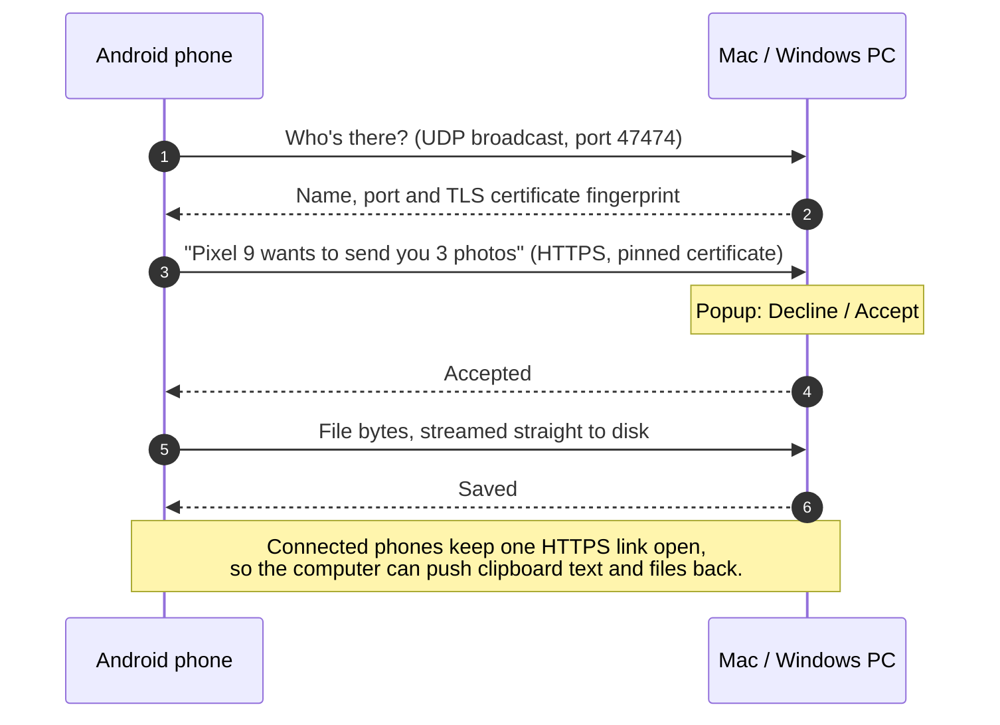

<div align="center">



<br>

[](https://github.com/Abhiroop1122/flick/releases/latest)
[](https://github.com/Abhiroop1122/flick/actions/workflows/build.yml)
[](LICENSE)


**Send photos, videos, files and links between your Android phone and your computer,<br>and share one clipboard between them. Over your own Wi-Fi. No cable, no account, no cloud.**

[**Download**](#download) · [**Quick start**](#quick-start) · [**Documentation**](#documentation) · [**Changelog**](CHANGELOG.md) · [**Report a bug**](https://github.com/Abhiroop1122/flick/issues/new/choose)

</div>

---

## Why Flick

AirDrop makes sending a photo from an iPhone to a Mac feel like nothing at all. If your
phone runs Android, or your computer runs Windows, you're back to cables, chat apps
that squash your photos, or cloud drives that need an account and the internet.

**Flick brings the AirDrop experience to Android, Mac and Windows.** Tap **Share →
Flick** on the phone, accept on the computer, done. The file goes straight across your
Wi-Fi, encrypted, at full quality. And it works the other way round too: right-click a
file on the computer to send it to the phone, or copy text on one device and paste it
on the other.

## Features

<table>
<tr>
<td width="33%" valign="top">
<br>
<b>Phone → computer</b><br>
<sub>In any app, tap <b>Share → Flick</b>, pick your computer and accept the popup. Files land in Downloads, links open in the browser, text goes on the clipboard.</sub>
</td>
<td width="33%" valign="top">
<br>
<b>Computer → phone</b><br>
<sub>Right-click → <b>Send to → Phone (Flick)</b> on Windows, or <b>Quick Actions → Send with Flick</b> on a Mac. Photos land in the gallery.</sub>
</td>
<td width="33%" valign="top">
<br>
<b>One clipboard</b><br>
<sub>Copy on the computer, paste on the phone, and the other way round. Passwords from password managers are never shared.</sub>
</td>
</tr>
<tr>
<td width="33%" valign="top">
<br>
<b>Always on, featherweight</b><br>
<sub>Open it once on the computer. It runs in the background, starts by itself after a restart, and uses about 8–11 MB of memory.</sub>
</td>
<td width="33%" valign="top">
<br>
<b>Private by design</b><br>
<sub>Direct, encrypted transfers with certificate pinning. No servers, no accounts, no analytics. Only phones you connect can send without asking.</sub>
</td>
<td width="33%" valign="top">
<br>
<b>Finds itself</b><br>
<sub>Computers on your Wi-Fi just appear, and your favourite one shows up in Android's Direct Share row. Works over the phone's hotspot too.</sub>
</td>
</tr>
</table>

## Download

| Platform | Requires | Download |
|---|---|---|
| **Android** | Android 8.0 or newer | [`Flick-2.2.2.apk`](https://github.com/Abhiroop1122/flick/releases/latest/download/Flick-2.2.2.apk) |
| **macOS** | macOS 12 or newer, Apple Silicon or Intel | [`Flick-mac.zip`](https://github.com/Abhiroop1122/flick/releases/latest/download/Flick-mac.zip) |
| **Windows** | Windows 10 or 11, 64-bit | [`Flick.exe`](https://github.com/Abhiroop1122/flick/releases/latest/download/Flick.exe) |

All files and their SHA-256 checksums are on the [latest release](https://github.com/Abhiroop1122/flick/releases/latest).

> [!NOTE]
> Flick isn't in the Play Store yet, and the desktop apps aren't signed by Apple or
> Microsoft. Expect a one-time warning when you first open each one;
> [the install guide](docs/INSTALL.md) shows exactly what to click.

## Quick start

1. **Computer:** open Flick once. It installs itself and says *"Flick is on"*.
2. **Phone:** install the APK and open Flick once.
   If Android says *"App blocked to protect your device"*, follow
   [these steps](docs/INSTALL.md#android) (a one-time Play Protect setting).
3. With both on the **same Wi-Fi**, tap **Share → Flick** in any app, pick your
   computer, and click **Accept** on the computer.
4. In the Flick app, tap **Connect** next to your computer (then **Connect** on the
   computer) to send from the computer to the phone and share the clipboard.
5. Optional: turn on **Send what I copy on this phone** so your copies reach the
   computer automatically.

The [user guide](docs/USER-GUIDE.md) covers every feature and setting.

## How it works



- **The computer app** is a single small native program (Go, no browser engine) that
  runs in the background: a LaunchAgent on macOS, a start-up entry with a tray icon on
  Windows.
- **Discovery** uses a UDP broadcast, plus Bonjour on macOS. Every computer has its own
  TLS certificate, and the phone pins its fingerprint, so nobody else on the Wi-Fi can
  read or fake a transfer.
- **Two-way without open ports on the phone:** a connected phone keeps one HTTPS request
  open to the computer, and the computer pushes clipboard text and file offers down it.
- **Phone → computer clipboard** uses an optional Accessibility helper that only reacts
  to the moment you tap *Copy*, because Android doesn't let apps read the clipboard in
  the background.

More in [Architecture](docs/ARCHITECTURE.md) and the [protocol spec](docs/PROTOCOL.md).

## Documentation

| Guide | What's inside |
|---|---|
| [**Install**](docs/INSTALL.md) | Installing, updating, turning off and removing Flick on each platform |
| [**User guide**](docs/USER-GUIDE.md) | Every feature and setting, on every device |
| [**Troubleshooting**](docs/TROUBLESHOOTING.md) | The computer doesn't show up, the clipboard doesn't arrive, and other fixes |
| [**Security & privacy**](docs/SECURITY.md) | What travels where, how it's protected, what's stored |
| [**Architecture**](docs/ARCHITECTURE.md) | How the apps are built |
| [**Protocol**](docs/PROTOCOL.md) | The network protocol, endpoint by endpoint |
| [**Building**](docs/BUILDING.md) | Building from source, signing, tests, CI and releases |

## Built with

| Android app | Computer app |
|---|---|
| Kotlin, Jetpack Compose (Material 3) | Go, `CGO_ENABLED=0`, one code base for macOS and Windows |
| OkHttp with certificate pinning, kotlinx.serialization | `crypto/tls` (ECDSA P-256), `net/http`, UDP discovery |
| Foreground services, MediaStore, Direct Share, Quick Settings tile | macOS: LaunchAgent, AppleScript dialogs, NSPasteboard via [purego](https://github.com/ebitengine/purego), Bonjour |
| Accessibility service for automatic copy | Windows: pure Win32 through [x/sys/windows](https://pkg.go.dev/golang.org/x/sys/windows): tray icon, Task Dialogs, clipboard listener |

## Project structure

```
.
├── android/                  Android app
│   ├── core/                 protocol, discovery, HTTPS client, transfers (pure Kotlin, JVM-tested)
│   └── app/                  share target, background services, clipboard helper, UI
├── desktop/                  macOS + Windows app (Go)
│   ├── server.go             HTTPS API, sessions, trust
│   ├── link.go               live link, clipboard push, computer → phone files
│   ├── discovery.go          UDP responder
│   ├── platform_darwin.go    macOS integration
│   ├── platform_windows.go   Windows integration
│   └── build.sh              builds Flick.exe and the universal Flick.app
├── docs/                     guides, protocol spec, design assets
├── scripts/e2e.sh            end-to-end tests: real phone networking code vs the real desktop app
└── .github/                  CI, issue and pull request templates
```

## Build from source

```bash
# macOS + Windows apps (Go 1.26+)
cd desktop && ./build.sh            # → dist/Flick.exe, dist/Flick.app, dist/Flick-mac.zip

# Android app (JDK 17+, Android SDK 36)
cd android && ./gradlew :app:assembleRelease

# 19 end-to-end tests: the phone's networking code against the real desktop app
./scripts/e2e.sh
```

See [Building](docs/BUILDING.md) for signing, CI and the release checklist.

## Roadmap

- [ ] Publish on Google Play (removes the Play Protect step)
- [ ] Signed and notarized macOS app, signed Windows app (no first-run warnings)
- [ ] Images on the shared clipboard
- [ ] Linux desktop app (the Go code already builds on Linux)

Ideas and feedback are welcome in [Issues](https://github.com/Abhiroop1122/flick/issues).

## Contributing

Contributions are welcome. Please read [CONTRIBUTING.md](CONTRIBUTING.md) first, and
report security issues privately as described in the [security policy](.github/SECURITY.md).

## License

[MIT](LICENSE) © 2026 Abhiroop1122
